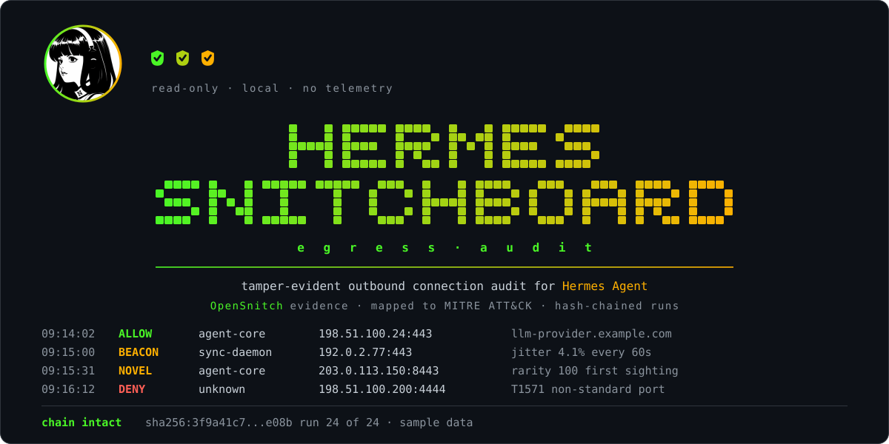

<div align="center">



**A dashboard plugin for [Hermes Agent](https://github.com/NousResearch/hermes-agent) that turns
[OpenSnitch](https://github.com/evilsocket/opensnitch) connection evidence into a plain-language,
tamper-evident view of what your machine really connected to.**

[](#licence)
[](https://www.python.org/)
[](#requirements)
[](#project-status)

</div>

---

> **This is an unofficial, community-built plugin.** It is not affiliated with, endorsed by, or
> supported by Nous Research or by the OpenSnitch project. Hermes Agent and OpenSnitch are separate
> projects with their own licences and maintainers.

---

## Project status

Pre-alpha. The requirements are written and the build has not started. There is nothing to install yet.

The plan, scope and success criteria are in the [product requirements](docs/HSB-PRD-001-Product-Requirements.md).
This README describes the intended behaviour, and it will be revised as each part is built and tested.

## Why this exists

Hermes Agent can run commands, call tools and reach the network on your behalf. The agent can tell you
what it did, and application-level tooling can record which model requests it made. Neither tells you
what your machine actually connected to, or whether the record of it has been altered since.

OpenSnitch already sees every outbound connection and the process behind it. That evidence is detailed,
but it sits in a database few people read. Snitchboard presents it inside the Hermes dashboard: what is
new, what repeats like a heartbeat, what belongs to AI tooling, and how each finding maps to MITRE ATT&CK.
Each stored run is hash-chained to the one before it, so an edited record is detectable.

## How it works

Two parts, kept apart on purpose.

```
 OpenSnitch statistics database          (read-only, your own account)
            |
            v
   collector/snitchboard_collect.py      (optional, run by you, never by Hermes)
            |   one JSON run record per run, hash-chained
            v
   runs directory
            |
            v
   dashboard/plugin_api.py (GET only)  --->  Snitchboard tab in the Hermes dashboard
```

The plugin inside the dashboard reads run records from one configured directory and nothing else. It
never opens the firewall database. That keeps its privileges small, and it suits setups where Hermes runs
under a different account from the person who owns the machine.

Until you have collected real runs, the tab shows clearly labelled demonstration data, so you can see
every panel without installing OpenSnitch.

## What you will see

- Hourly coverage, with gaps shown as gaps. Absence of collection is never presented as an all-clear.
- Findings with severity, confidence, ATT&CK technique and tactic, the literal records behind them and a concrete next step.
- Beacon candidates, each with both the benign and the malicious explanation.
- Destinations that are new, ranked by rarity.
- Activity by AI process and by configured account.
- A **Verify chain** control that recomputes every hash and names the first run that does not match.

Addresses and names are masked by default, with a deliberate reveal control.

## What it will not do

- It does not block, allow, or change anything on the host. It observes and reports.
- It does not decrypt or describe traffic content. Connections are events with byte counts where measured.
- It makes no network calls and sends no telemetry.
- It does not prove that the records match the real network. The hash chain makes edits detectable, and
  someone able to rewrite every record could recompute it.

## Documentation

| Document | Covers |
|---|---|
| [Product requirements](docs/HSB-PRD-001-Product-Requirements.md) | Problem, success criteria, scope, design, analysis rules, security and privacy requirements, plan and risks |

## Requirements

- Hermes Agent v0.23.0 or later, with the web dashboard
- Linux
- OpenSnitch, only if you want live data. Demonstration mode needs nothing else

## Installation

Not yet available. Installation instructions will be added once the plugin passes validation and is
submitted to the Hermes plugin catalogue.

## Roadmap

| Stage | Work | State |
|---|---|---|
| Requirements | Problem, scope, design and plan | Draft, awaiting sign-off |
| Core | Run record schema, hashing, analysis engine, tests | Not started |
| Dashboard | Backend routes and the tab, with demonstration data | Not started |
| Collector | Reference script for the OpenSnitch statistics database | Not started |
| Release | Validation, screenshots, catalogue submission | Not started |

## Contributing

Contribution guidelines will be published with the first tagged release.

## Licence

Dual licensed under either of:

- MIT licence ([LICENSE-MIT](LICENSE-MIT) or <https://opensource.org/licenses/MIT>)
- Apache Licence, Version 2.0 ([LICENSE-APACHE](LICENSE-APACHE) or <https://www.apache.org/licenses/LICENSE-2.0>)

at your option. Unless you state otherwise, any contribution you intentionally submit for inclusion in
this work is dual licensed on the same terms, with no additional conditions.

Hermes Agent and OpenSnitch are separate projects and are not redistributed by this one.

## Acknowledgements

Built for [Hermes Agent](https://github.com/NousResearch/hermes-agent) by
[Nous Research](https://nousresearch.com), using the evidence that
[OpenSnitch](https://github.com/evilsocket/opensnitch) collects. Findings are mapped to
[MITRE ATT&CK](https://attack.mitre.org/).

The avatar set in the banner is the Nous Research character mark, which also ships in the Hermes
Agent repository under `assets/`. It appears here as a visual nod to the project this plugin is
built for, and it carries no suggestion of endorsement. The notice at the head of this document
governs: this plugin is unofficial, and Nous Research neither supports nor sponsors it.

## References

- [Hermes Agent, extending the dashboard](https://hermes-agent.nousresearch.com/docs/user-guide/features/extending-the-dashboard)
- [Hermes Agent, plugin developer guide](https://hermes-agent.nousresearch.com/docs/developer-guide/plugins)
- [Hermes Agent, submitting to the plugin catalogue](https://hermes-agent.nousresearch.com/docs/developer-guide/plugins/catalog-submission)
- [OpenSnitch](https://github.com/evilsocket/opensnitch)
- [MITRE ATT&CK](https://attack.mitre.org/)
