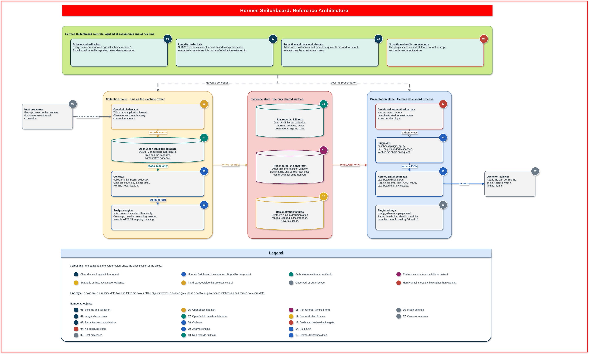
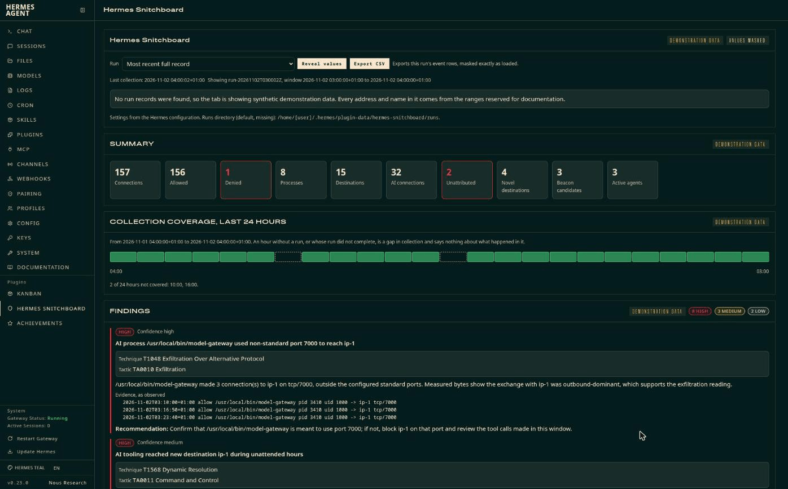
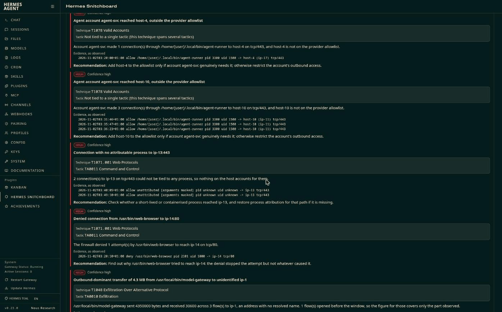
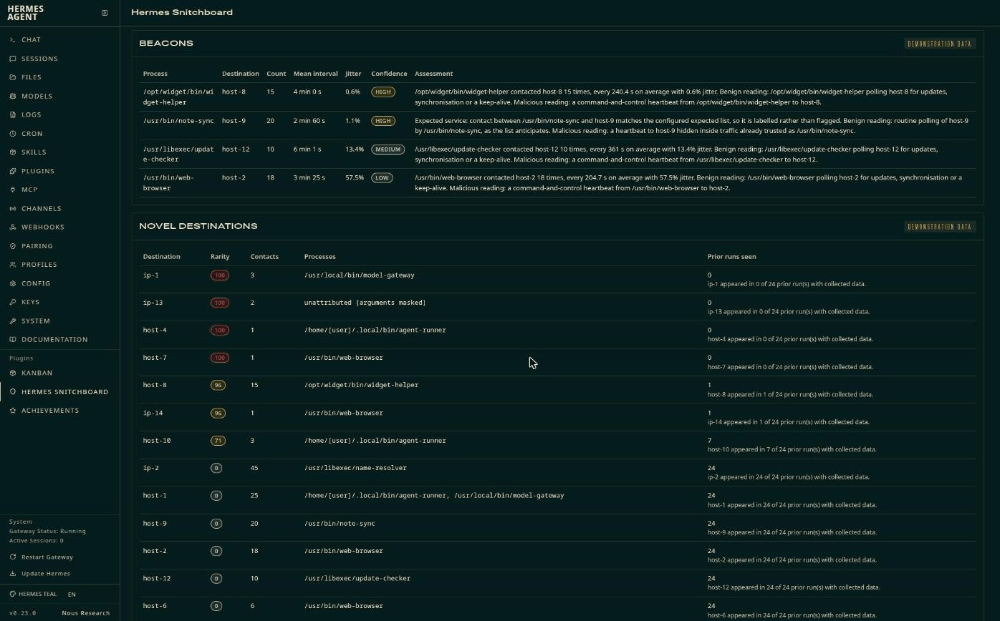
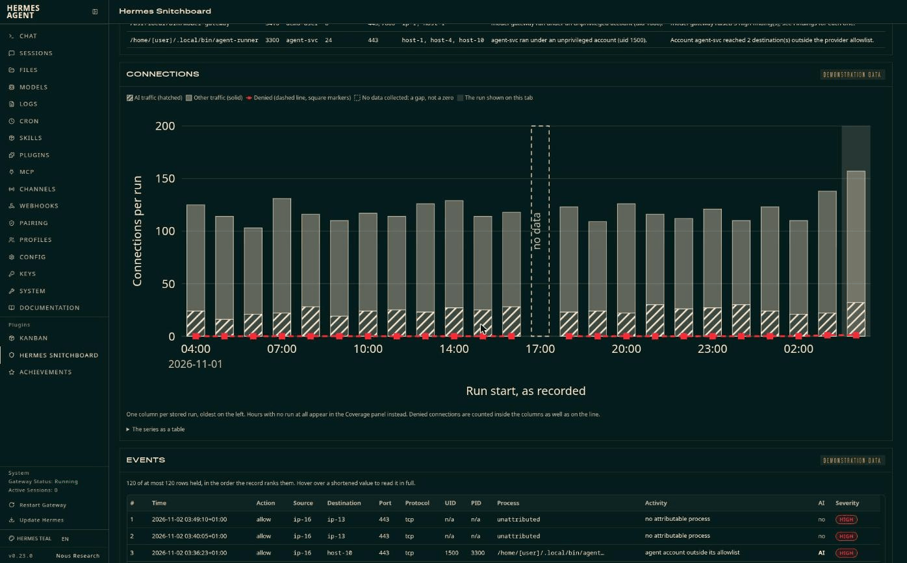
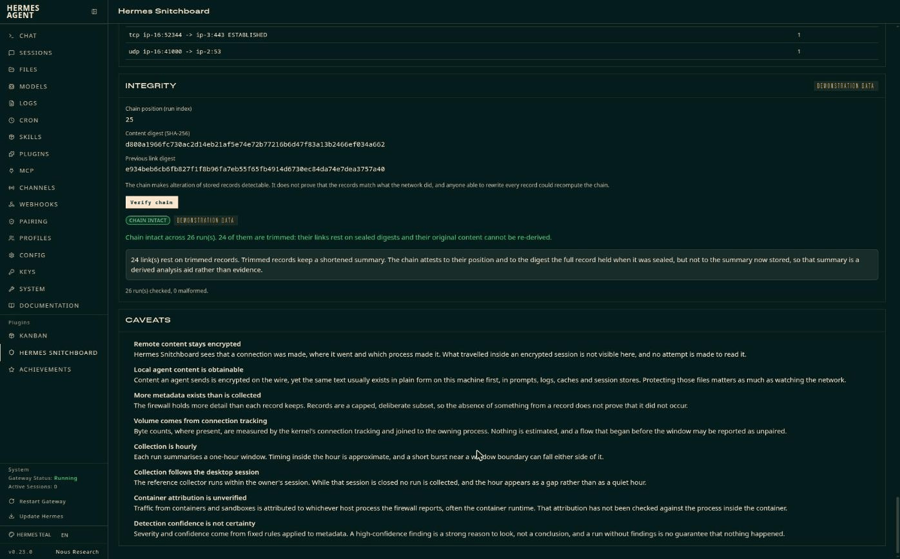

<div align="center">


**A dashboard plugin for [Hermes Agent](https://github.com/NousResearch/hermes-agent) that turns
[OpenSnitch](https://github.com/evilsocket/opensnitch) connection evidence into a plain-language,
tamper-evident view of what your machine really connected to.**

[](#-project-status)
[](#-project-status)
[](#-requirements)
[](#-requirements)
[](#-conventions)
[](#-what-it-will-not-do)
[](#-development)
[](#-conventions)
[](#-licence)

Maintained by **[NeumannTechTips](https://github.com/NeumannTechTips)** &middot; Requirements version 1.3 &middot; Reviewed: November 2026

`#HermesAgent` `#OpenSnitch` `#MITREATTACK` `#EgressMonitoring` `#AgenticAI` `#AIGovernance` `#Linux` `#SecurityTooling` `#TamperEvident` `#Observability` `#ZeroTelemetry` `#Python`

</div>

---

> ⚠️ **This is an unofficial, community-built plugin.** It is not affiliated with, endorsed by, or supported by Nous Research or by the OpenSnitch project. Hermes Agent and OpenSnitch are separate projects with their own licences and maintainers.

---

## 📖 Table of contents

- [Project status](#-project-status)
- [Why this exists](#-why-this-exists)
- [How it works](#-how-it-works)
- [What you will see](#-what-you-will-see)
- [Screenshots](#-screenshots)
- [What it will not do](#-what-it-will-not-do)
- [Requirements](#-requirements)
- [Installation](#-installation)
- [Collecting real data](#-collecting-real-data)
- [Settings](#-settings)
- [Repository map](#-repository-map)
- [Development](#-development)
- [Documentation](#-documentation)
- [Roadmap](#-roadmap)
- [Conventions](#-conventions)
- [Contributing](#-contributing)
- [Licence](#-licence)
- [Acknowledgements](#-acknowledgements)
- [References](#-references)

---

## 🚦 Project status

**v0.1.0, tagged and signed.** Both halves are built. The viewer runs inside a Hermes dashboard and has been checked panel by panel against a live instance; the reference collector reads an OpenSnitch database and writes hash-chained records. Demonstration mode needs nothing beyond Hermes, so the plugin can be judged before it is pointed at a real machine.

> 💡 **What alpha means here.** The analysis rules, the record schema and the integrity chain are settled and covered by 264 tests. What has not happened is exposure to other people's machines, other distributions, other OpenSnitch versions, and histories larger than a few dozen runs. Treat a finding as a reason to look, never as a verdict.

---

## 🎯 Why this exists

Hermes Agent can run commands, call tools and reach the network on your behalf. The agent can tell you what it did, and application-level tooling can record which model requests it made. Neither tells you what your machine actually connected to, nor whether the record of it has been altered since.

OpenSnitch already sees every outbound connection and the process behind it. That evidence is detailed, but it sits in a database few people read. Hermes Snitchboard presents it inside the Hermes dashboard: what is new, what repeats like a heartbeat, what belongs to AI tooling, and how each finding maps to MITRE ATT&CK. Every stored run is hash-chained to the one before it, so an edited record becomes detectable.

> 💡 **The distinction worth holding onto.** Application-layer tooling records what the agent says it sent. Hermes Snitchboard records what the operating system observed leaving.

---

## 🧭 How it works

Two parts, kept apart on purpose.

[](docs/assets/hermes-snitchboard-reference-architecture.png)

*HSB-ARC-001. Seventeen numbered objects, coloured by classification rather than by type, so the view survives a greyscale print. Source: [`hermes-snitchboard-reference-architecture.drawio`](docs/assets/hermes-snitchboard-reference-architecture.drawio).*

The same path, named by file:

```
 OpenSnitch statistics database        read-only, your own account
            |
            v
 collector/snitchboard_collect.py      optional, run by you, never by Hermes
            |   one JSON run record per collection, hash-chained
            v
 runs directory
            |
            v
 dashboard/plugin_api.py (GET only) -> Hermes Snitchboard tab in the dashboard
```

The component inside the dashboard reads run records from one configured directory and nothing else. It never opens the firewall database. That keeps its privileges small, and it suits setups where Hermes runs under a different account from the person who owns the machine.

Until you have collected real runs, the tab shows clearly labelled demonstration data, so every panel is visible without installing OpenSnitch.

> ⚠️ **What the collector cannot see.** Three limits follow from how OpenSnitch stores connections. [`collector/README.md`](collector/README.md) covers them, and setup, in full.
>
> - **The time zone must match the GUI's.** OpenSnitch stores times without an offset, so the collector reads them as its own machine's local time. Run it under the same time zone as the OpenSnitch GUI.
> - **The repeated hour at a clock change is ambiguous.** When clocks go back, a time without an offset cannot say which of the two copies of that hour it belongs to, so rows from that hour may be placed in the wrong window.
> - **The GUI must be running.** The GUI, not the firewall daemon, writes connections to the database, and only while it is open. An hour when it was closed is recorded as `no_data` and shown as a coverage gap, never as a quiet hour.

---

## 🖥️ What you will see

| Panel | Content |
|---|---|
| 📊 **Summary** | Connections, denials, unique processes and destinations, AI traffic, unattributed traffic |
| ⏱️ **Coverage** | One slot per hour. An hour with no collection is drawn as a gap, never as a quiet hour |
| 🛡️ **Findings** | Severity, confidence, ATT&CK technique and tactic, the literal records behind each finding, and a concrete next step |
| 📡 **Beacons** | Regular-interval destinations, each carrying both the benign and the malicious explanation |
| ✨ **Novel destinations** | Addresses not seen in earlier runs, ranked by rarity |
| 🤖 **Agents** | Activity by AI process and by configured account |
| 📈 **Chart** | One column per stored run, with a run that collected nothing marked rather than drawn as zero |
| 📋 **Events** | The connection rows the record kept, in the order it ranks them |
| 🧮 **Aggregates** | Destinations, processes, accounts, ports and protocols, each against its cap |
| 💾 **Volume** | Bytes sent and received, only where the record carries byte counts. The reference collector supplies none, because the firewall database holds none, so with live data from that collector the panel reports volume as unavailable |
| 🔥 **Daemon state** | What the firewall reported about itself when the run was collected |
| 📜 **Rules in force** | The rules present at collection time, with denials marked |
| 🔌 **Sockets** | Open sockets as the firewall saw them |
| 🔗 **Integrity** | Run digests, chain position, and a control that recomputes every link |
| ⚠️ **Caveats** | What the evidence cannot tell you, stated on the page rather than buried in documentation |

Addresses, host names, hardware addresses, home directories and process arguments are masked by default. A deliberate control reveals them, and that control can be switched off entirely.

> ⚠️ **Account names are shown in clear.** Home paths are masked because a path under `/home` names an account, but in this release the account names themselves, in the agents panel and the accounts aggregate, are not masked. Records from the collector carry real account names, resolved from each connection's uid. Masking them is a v0.2.0 item.

---

## 📸 Screenshots

Taken from demonstration mode, so every address and name in them is synthetic.

| | |
|---|---|
|  |  |
| **Summary and coverage.** Missing hours read as gaps. | **Findings.** Technique, evidence, one next step. |
|  |  |
| **Beacons and novelty.** Both readings, every time. | **Chart and events.** A run that collected nothing is marked, not zeroed. |
|  | |
| **Integrity.** Recomputed on request. | |

---

## 🚫 What it will not do

> ⚠️ These are design limits, not gaps awaiting a later release.

| Limit | Why |
|---|---|
| 🔒 Never blocks, allows or changes anything on the host | It observes and reports. Enforcement belongs to the firewall |
| 🔐 Never decrypts or describes traffic content | Connections are events, with byte counts only where the record carries them, never payloads |
| 📴 Makes no network call and sends no telemetry | The plugin opens no socket and loads no external font, script or image |
| 🗝️ Reads no credential store | No `.env`, no `auth.json`, no browser profile, no key store |
| 🧾 Never writes to disk | The half that runs inside Hermes serves seven GET routes and nothing else |
| ⚖️ Does not prove what the network did | The chain makes alteration detectable. Someone able to rewrite every record could recompute it |

> ⚠️ **How far the integrity claim reaches.** The chain attests to the order of stored records and to the digest each full record held when it was sealed. A record that has since been trimmed keeps a shortened summary the chain does not cover, so that summary is a derived analysis aid rather than evidence. The integrity panel says how many links rest on sealed digests rather than leaving you to work it out.

---

## ⚙️ Requirements

| Requirement | Detail |
|---|---|
| Hermes Agent | v0.23.0 or later, with the web dashboard |
| Operating system | Linux |
| OpenSnitch | Needed only for live data. Demonstration mode needs nothing else |
| Python packages | None. The engine uses the standard library alone |

---

## 📦 Installation

Install straight from this repository:

```bash
hermes plugins install NeumannTechTips/hermes-snitchboard
hermes plugins enable hermes-snitchboard
```

> ⚠️ **Enabling is a separate step.** Hermes plugins are opt-in: an installed plugin that has not been enabled does not load, and its tab never appears. `hermes plugins list` shows the state of each one.

Routes mount when the dashboard starts, so restart it once after enabling:

```bash
hermes dashboard --stop
hermes dashboard
```

The tab appears in the sidebar under Plugins, and opens at `/hermes-snitchboard`.

> 💡 **Nothing further is needed to look around.** With no run records present the tab loads demonstration data and labels every panel accordingly, so you can judge the thing before pointing it at your own machine.

> 💡 **Checking what you installed.** Every commit is signed and shows as Verified on GitHub, and releases are tagged. `git verify-tag v0.1.0` in a clone confirms the tag, and `git log --show-signature` confirms the commits.

---

## 🛰️ Collecting real data

The dashboard shows demonstration data until run records exist. Writing them is the collector's job, and it runs under your own account rather than under Hermes.

```bash
python3 collector/snitchboard_collect.py \
  --db /path/to/opensnitch.db \
  --runs-dir ~/.hermes/plugin-data/hermes-snitchboard/runs \
  --dry-run
```

`--db` has no default, deliberately: OpenSnitch keeps its statistics in memory unless you configure a file, so there is no path worth guessing. The dry run reports what it would write without writing anything, and prints no address, host name or process path.

Drop `--dry-run` to write a record, then point the plugin's `runs_dir` setting at the same directory. [`collector/systemd/`](collector/systemd) holds user timer templates for running it hourly, and [`collector/README.md`](collector/README.md) covers permissions when Hermes runs under a separate account.

> ⚠️ **Read the three limits above first.** Time zone, the repeated hour at a clock change, and the GUI needing to be open all shape what a collected record can and cannot tell you.

---

## 🎛️ Settings

Set under `plugins.entries.hermes-snitchboard.settings` in your Hermes configuration.

| Setting | Default | Purpose |
|---|---|---|
| `runs_dir` | `""` | Directory of run records. Empty means the plugin data directory |
| `mode` | `auto` | `auto`, `demo` or `live`. Automatic falls back to demonstration data when no records exist |
| `ai_process_names` | `[]` | Process names to treat as AI tooling |
| `agent_accounts` | `[]` | Accounts the agent runs under, by name or numeric uid |
| `expected_services` | `[]` | Regular contact that should be labelled rather than flagged |
| `provider_allowlist` | `[]` | Destinations agent accounts may reach without raising a high-severity finding |
| `unattended_hours` | `[]` | Local hours, 0 to 23, when nobody is expected to be directing the agent |
| `redact_by_default` | `true` | Mask addresses, host names, hardware addresses and process arguments |
| `allow_reveal` | `true` | Offer the control that reveals masked values |
| `retention_days` | `14` | Days a record stays in full form before it is trimmed, never deleted |
| `telemetry_destinations` | `[]` | Third-party telemetry endpoints; AI tooling reaching one raises a medium finding |
| `trimmed_max_bytes` | `8192` | Byte ceiling for a trimmed record, from 1024 to 204800 |

> ⚠️ **Analysis thresholds are not yet settings.** Beacon windows and jitter bands, novelty depth, coverage tolerance, transfer thresholds and the detection and aggregate caps live in `snitchboard/config.py` and carry their defaults in this release. Only the twelve keys above reach the plugin from Hermes configuration. A threshold placed in the configuration file is dropped without any warning, and the default stays in force. The collector, by contrast, refuses a settings file that names one. Exposing them is a v0.2.0 item.

---

## 🗺️ Repository map

| Path | Contents | State |
|---|---|---|
| `snitchboard` | Analysis engine: schema, canonical hashing, chain, analysis, detection, severity, ATT&CK mapping, redaction, configuration | ✅ Built |
| `dashboard` | Manifest, seven read-only API routes, and the tab bundle | ✅ Built |
| `collector` | Reference collector and its systemd user timer templates | ✅ Built |
| `fixtures` | Synthetic demonstration records, documentation ranges only | ✅ Built |
| `tests` | 264 tests covering the analysis rules, the chain, redaction, the routes, the bundle and the collector | ✅ Built |
| `tools` | Demonstration generator and the history scanner that gates publication | ✅ Built |
| `docs` | Requirements, release checklist, banner, screenshots | ✅ Built |
| `.github/workflows` | Tests, plugin validation, history and fixture scans | 🚧 Not started |

---

## 🧪 Development

```bash
python3 -m unittest discover -s tests -t .     # the whole suite, no network, no database
python3 tools/gen_demo.py --help               # regenerate the demonstration fixtures
python3 tools/scan_history.py                  # the publication gate, reads every blob ever committed
```

The suite builds a synthetic OpenSnitch database from [`tests/fixtures/opensnitch_sample.sql`](tests/fixtures/opensnitch_sample.sql) in a temporary directory, so no firewall and no network are needed to exercise the collector.

The scanner reads its word list from `.scan-words`, which is deliberately gitignored. Without that file it reports the word check as skipped rather than passing, so a missing list can never be mistaken for a clean result.

---

## 📚 Documentation

| Document | What it gives you |
|---|---|
| [`docs/HSB-PRD-001-Product-Requirements.md`](docs/HSB-PRD-001-Product-Requirements.md) | Problem, success criteria, scope, design, analysis rules, security and privacy requirements, build plan, risks and the decisions taken |
| [`collector/README.md`](collector/README.md) | Collector setup, permissions across accounts, status rules and the limits of the OpenSnitch schema |
| [`docs/HSB-REL-001-Release-and-Recording-Checklist.md`](docs/HSB-REL-001-Release-and-Recording-Checklist.md) | Publication gate, capture discipline and the submission runbook |

> ⚠️ **The requirements govern.** When a decision changes, revise the requirements document first. Code follows from it, never the reverse.

---

## 🛣️ Roadmap

| Stage | Work | State |
|---|---|---|
| Requirements | Problem, scope, design, analysis rules and plan | ✅ Signed off |
| Core | Run record schema, canonical hashing, analysis engine, tests | ✅ Delivered |
| Dashboard | Backend routes and the tab, with demonstration data | ✅ Delivered |
| Collector | Reference script for the OpenSnitch statistics database | ✅ Delivered |
| Release | Validation, screenshots, v0.1.0 tagged | ✅ Delivered |
| Catalogue | Submission to the Hermes plugin catalogue | 🚧 In progress |
| v0.2.0 | Masking of account names, a single meaning for `aggregates.total_connections` and `aggregates.dropped`, analysis thresholds as settings, continuous integration, wider platform testing | 📋 Planned |

---

## 🔧 Conventions

| Item | Setting |
|---|---|
| Default branch | `main` |
| Commit signing | SSH, enabled globally. Commits show as Verified on GitHub |
| Commit messages | Imperative mood, describing the change rather than the file touched |
| Sign-off | Every commit carries a `Signed-off-by` line under the [Developer Certificate of Origin](https://developercertificate.org/) |
| Runtime dependencies | None. Anything beyond the standard library needs a recorded decision |
| Committed artefacts | Source only. No compiled binary, no bytecode, no minified bundle |
| Demonstration data | Synthetic, inside the ranges reserved by [RFC 5737](https://www.rfc-editor.org/rfc/rfc5737), [RFC 3849](https://www.rfc-editor.org/rfc/rfc3849) and [RFC 2606](https://www.rfc-editor.org/rfc/rfc2606) |
| Rendering | Record data reaches the page through React element construction, never through raw markup, because firewall-supplied names flow through that code |
| Language | Professional British English throughout |

> 🚫 **Never committed:** real capture data, OpenSnitch databases, run records from a live host, credentials, or any address, hostname or path belonging to a real machine. The [`.gitignore`](.gitignore) enforces these patterns as a safety net rather than as a substitute for checking `git status`.

---

## 🤝 Contributing

Issues are welcome, particularly reports from distributions and OpenSnitch versions other than the one this was built against. For a change of behaviour, raise the problem first: the requirements document is revised before the code is, and a pull request that arrives ahead of that conversation is harder to accept than it looks.

---

## 📄 Licence

Dual licensed under either of:

- MIT licence ([LICENSE-MIT](LICENSE-MIT) or <https://opensource.org/licenses/MIT>)
- Apache Licence, Version 2.0 ([LICENSE-APACHE](LICENSE-APACHE) or <https://www.apache.org/licenses/LICENSE-2.0>)

at your option. Unless you state otherwise, any contribution you intentionally submit for inclusion in this work is dual licensed on the same terms, with no additional conditions.

Hermes Agent and OpenSnitch are separate projects and neither is redistributed here.

---

## 🙏 Acknowledgements

Built for [Hermes Agent](https://github.com/NousResearch/hermes-agent) by [Nous Research](https://nousresearch.com), using the evidence that [OpenSnitch](https://github.com/evilsocket/opensnitch) collects. Findings are mapped to [MITRE ATT&CK](https://attack.mitre.org/).

The avatar set in the banner is the Nous Research character mark, which also ships in the Hermes Agent repository under `assets/`. It appears here as a visual nod to the project this plugin is built for, and it carries no suggestion of endorsement. The notice at the head of this document governs.

---

## 🔗 References

- [Hermes Agent, extending the dashboard](https://hermes-agent.nousresearch.com/docs/user-guide/features/extending-the-dashboard)
- [Hermes Agent, plugin developer guide](https://hermes-agent.nousresearch.com/docs/developer-guide/plugins)
- [Hermes Agent, submitting to the plugin catalogue](https://hermes-agent.nousresearch.com/docs/developer-guide/plugins/catalog-submission)
- [OpenSnitch](https://github.com/evilsocket/opensnitch)
- [MITRE ATT&CK](https://attack.mitre.org/)

---

<div align="center">

**Unofficial community plugin &middot; [NeumannTechTips](https://github.com/NeumannTechTips)**

</div>
